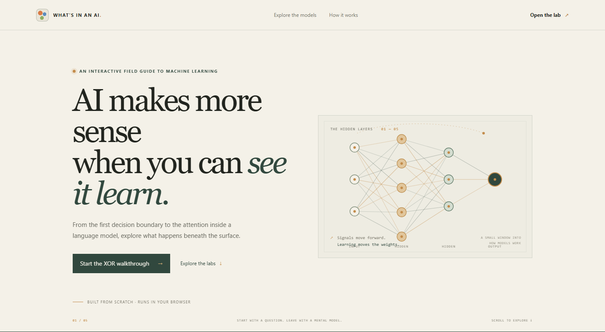

# What's In An AI

**An interactive field guide to machine learning.** Train small models in your browser and see what changes inside: weights, filters, decision boundaries, embeddings and attention.



This project is designed to make the ideas behind AI easier to explain and explore. Every model is implemented from scratch in TypeScript, with no machine learning library, and runs locally in your browser.

## Explore

| Lab | What you can explore |
| --- | --- |
| [Classical ML](https://tommciver.github.io/Whats-In-An-AI/#/classical) | Step through linear and logistic regression, k-means, decision trees and k-nearest neighbours. Compare how they learn and where they draw their boundaries. |
| [Neural networks](https://tommciver.github.io/Whats-In-An-AI/#/nn) | Train a multilayer network on toy datasets. Inspect its weights, biases, activations, loss and decision boundary as they change. |
| [Convolution](https://tommciver.github.io/Whats-In-An-AI/#/conv) | Train a small CNN to recognise hand-drawn shapes. See its filters and feature maps, then draw an input of your own. |
| [Embeddings](https://tommciver.github.io/Whats-In-An-AI/#/embeddings) | Train 2D word vectors to predict nearby context words. Inspect coordinates, cosine neighbours and context probabilities. |
| [Attention](https://tommciver.github.io/Whats-In-An-AI/#/attention) | Train a tiny multi-head attention model on a copy task and inspect which earlier tokens each head reads. |

The [overview page](https://tommciver.github.io/Whats-In-An-AI/) introduces the ideas and suggests a path through the labs.

## Guided interview walkthroughs

Open **Interview guide** in any lab for a short walkthrough. Each step can set up or run its experiment for you, then gives you a cue for what to watch and an interview question to practise answering. Start with the XOR walkthrough from the overview page: it opens the neural network lab with XOR and a network without hidden layers already selected. Every lab, including embeddings, has its own guide.

## A few experiments

- **Neural networks:** Try XOR with no hidden layer, then add one. A single linear boundary cannot separate the XOR classes.
- **Features and depth:** Add squared input features and see how that changes the boundary the network can draw.
- **Classical models:** Fit a straight line to curved data. Gradient descent can converge while the model still misses the pattern.
- **Convolution:** Watch random filters change during training, then draw a shape and inspect the resulting feature maps.
- **Embeddings:** Train on a tiny curated co-occurrence corpus, then compare neighbours and context predictions for words such as `cat` and `kitten`. The distances reflect this teaching corpus, not general semantic meaning.
- **Attention:** Train on copied sequences and watch attention concentrate on the matching position in the prefix.

## Run locally

```bash
npm install
npm run dev       # http://localhost:5173
npm run verify    # numerical gradient checks and behaviour checks
npm run build     # TypeScript check and production build
```

## How it works

- **Neural network:** A multilayer perceptron trained with mini-batch SGD. The graph maps edge colour and thickness to weight sign and size; node fill shows activation for a movable probe point.
- **Classical models:** Five algorithms with visuals chosen to expose their learning process, including separate assign/move steps for k-means and one-level-at-a-time tree growth.
- **Convolution:** `conv 3×3 → ReLU → 2×2 max pool → dense → softmax`, with gradients flowing through the pool selections and ReLU gates into the filters.
- **Embeddings:** A skip-gram style model learns a two-dimensional input vector for each of ten focus words. Full-softmax predictions of observed context words provide the training signal. The plot shows those learned input vectors directly.
- **Attention:** A small causal, multi-head self-attention model trained on a copy task. Per-head matrices show which earlier positions contribute to each prediction.

Training runs in the browser. The seeded datasets and model initialisation make experiments reproducible. Canvas and SVG visuals read the model state directly, so the displayed parameters and predictions come from the same implementation that is training.

## Checking the maths

`npm run verify` compares analytical gradients with numerical estimates and checks expected model behaviour, including cases that should fail:

```text
NEURAL NET
  rel error 1.5e-11    backprop vs numerical gradient
  gauss  [2,1]       train  99.0%   test  97.8%
  xor    [2,1]       train  52.4%   test  44.4%   <- expected failure: no hidden layer
  xor    [2,4,1]     train 100.0%   test  98.9%
  spiral [2,8,8,1]   train  91.0%   test  85.6%

CONVOLUTION
  rel error 2.8e-11    gradient through conv -> ReLU -> pool -> dense -> softmax
  test acc 100%        from 33.8% (chance 25%)
  filter drift 12.67   filters moved from initialisation

ATTENTION
  rel error 0.0        gradient through the attention softmax
  test acc 100%        on unseen sequences, from 19.3% (chance 20%)
  attention concentrates 84-94% on the matching position

EMBEDDINGS
  pair loss 3.366 -> 1.676 after 120 epochs
  shared-context neighbours and seeded training checked
```

These figures are representative outputs from the verification scripts, not performance claims for general datasets.

## Built with

React, TypeScript and Vite. Model code lives in `src/lib/`; interactive labs live in `src/labs/`; shared visualisations live in `src/components/`.

## GitHub Pages

The [live demo](https://tommciver.github.io/Whats-In-An-AI/) is published with GitHub Pages. A GitHub Actions workflow builds and deploys it on pushes to `main` and can also be run manually.

## Branch workflow

GitHub Pages deploys from `main`. Feature work can use `feat/*` or `fix/*` branches and the `staging` integration branch before merging into `main`.
